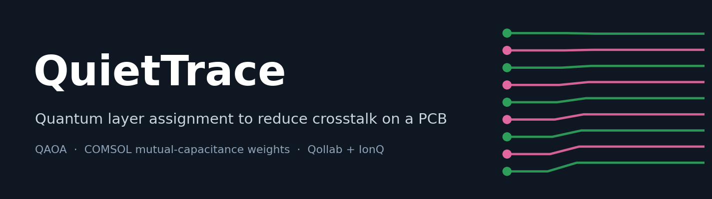
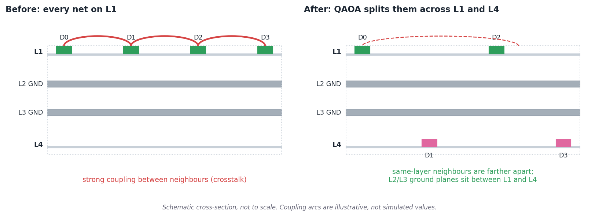
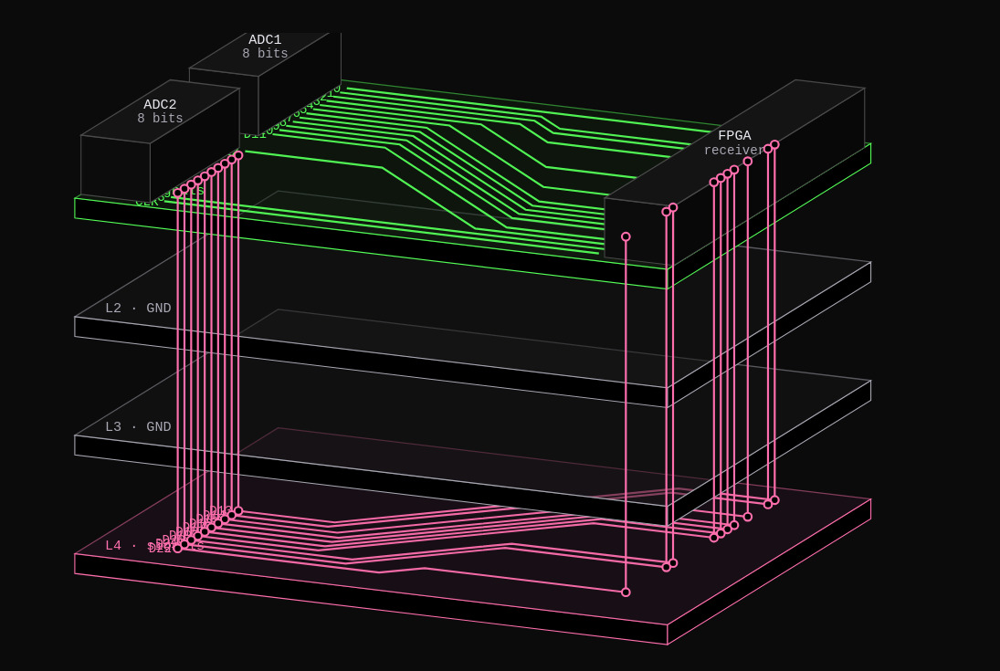
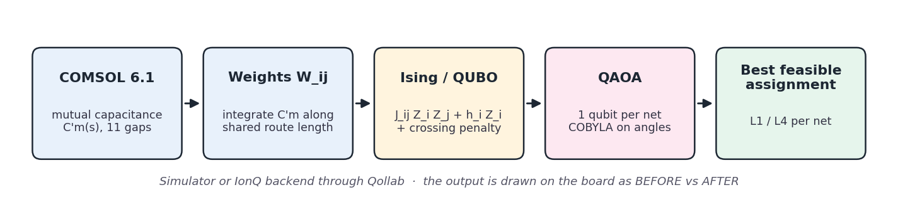
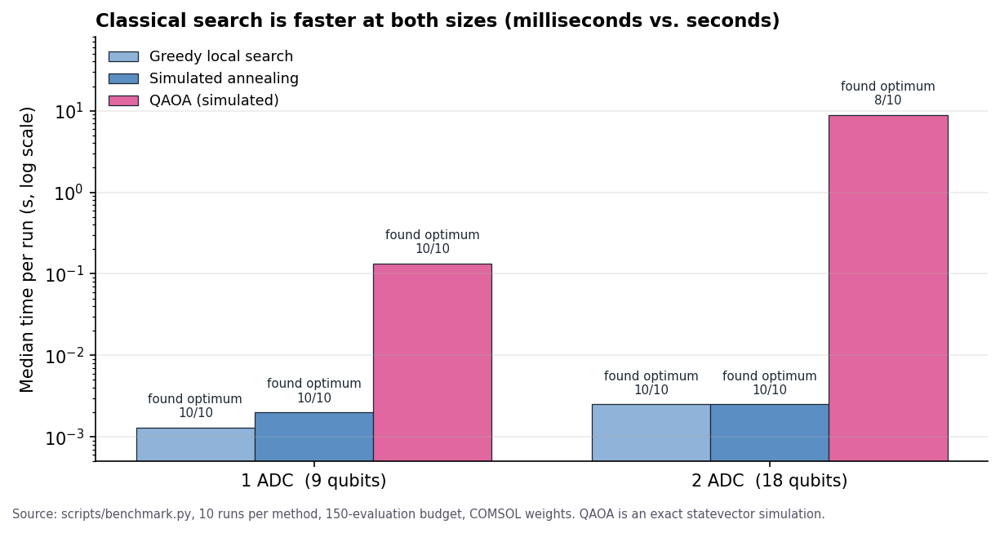
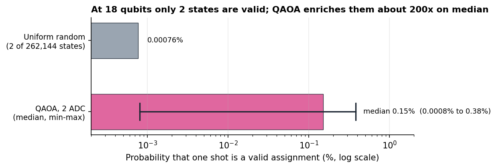

**This effort is supported by Qollab & IonQ**



# QuietTrace: Quantum Layer Assignment to Reduce PCB Crosstalk

**Theme:** Quantum Impact· **Status:** Hackathon submission (Qollab) · [Project page on Qollab](https://qollab.xyz) <!-- TODO: exact project URL -->

**In one line:** QuietTrace decides which nets of an ADC→FPGA bus go on the top layer (L1) and which on the bottom layer (L4), using **coupling weights computed from a COMSOL electrostatic simulation**, and solves the assignment with QAOA. It finds the exact optimum in 10/10 runs at 9 qubits and 8/10 at 18 qubits (simulated). **Classical search is faster at both sizes, and we do not claim a quantum speedup.**

## 1. What is it?

Two nearby parallel traces on the same layer couple electromagnetically, which is called **crosstalk**. The longer they run side by side and the closer they are, the worse it gets. On a board with two signal layers (L1 and L4, with ground planes L2 and L3 in between), moving some nets to the other layer is one of the cheapest ways to reduce it.

QuietTrace takes the nets of an ADC→FPGA bus (`D0`–`D7` and `CLK`, per ADC), builds a **coupling weight** for every pair of nets, and chooses a layer for each net so that the total coupling between nets sharing a layer is as small as possible. Nets whose routes **cross** must end up on different layers (a hard constraint). The problem is written as an Ising/QUBO cost with one qubit per net and solved with QAOA, on the simulator or on IonQ hardware through Qollab.



<p align="center"></p>
<p align="center"><em>Actual output for 2 ADCs (8 bits each) → FPGA receiver. L1 (green) and L4 (pink) carry signals; L2 and L3 are ground planes.</em></p>

## 2. Why does it matter, and who is it for?

It is for PCB designers of mixed-signal and high-speed boards who need to decide, for a parallel bus, which lines share a layer, and for quantum developers who want a small, physically motivated problem with an honest classical benchmark.

What sets this apart from a generic "toy" Max-Cut is where the numbers come from: the weights are not made up or purely geometric. They come from **COMSOL 6.1 mutual-capacitance simulations** (section 3), so the cost function follows a physical quantity that a hardware engineer recognises.

## 3. How does it work?



**Cost.** One binary variable per net, $x_i \in [0, 1]$ (0 = L1, 1 = L4):

$$
C(\mathbf{x}) = \sum_{i \lt j} W_{ij}\,[x_i = x_j] \;+\; \lambda \sum_{(i,j)\in\mathcal{K}} [x_i = x_j]
$$

where $[\cdot]$ is 1 if the condition holds and 0 otherwise, $W_{ij}$ is the coupling weight between nets $i$ and $j$, $\mathcal{K}$ is the set of pairs whose routes cross, and $\lambda$ is the conflict penalty (the **Conflict weight** in the UI). This maps to the Ising Hamiltonian

$$
H = \sum_{i \lt j} J_{ij}\, Z_i Z_j + \sum_i h_i\, Z_i ,
$$

which is the QAOA cost operator.

**Weights from COMSOL.** We simulated the mutual capacitance per unit length $C'_m(s)$ as a function of the spacing $s$ between two traces (11 gaps, 0.2–4 mm, in `quantum/comsol_capacitance.csv`). For each pair of nets, the weight integrates it along the length $L_{ij}$ where the two routes run together:

$$
w_{ij} = \frac{1}{C_\mathrm{ref}} \int_0^{L_{ij}} C'_m\big(s(\ell)\big)\,\mathrm{d}\ell
$$

where $s(\ell)$ is the spacing between the two traces at position $\ell$ along the shared run and $C_\mathrm{ref}$ is a normalisation constant.

(`quantum/capacitance.py`: log-log interpolation between the simulated gaps and a power-law tail beyond them.) Qollab uses only these COMSOL weights. A purely geometric heuristic (`modelo.geometric_weights`) remains in the code as a fallback for the local dev preview. The COMSOL weights are a **quasi-electrostatic proxy**: they capture capacitive coupling only. Inductive coupling and signal rise times are not modeled.

**QAOA.** `quantum/fastqaoa.py` simulates the QAOA ansatz exactly in NumPy and optimizes the angles with COBYLA. The reference implementation with Qiskit's `QAOAAnsatz` is kept in `quantum/qaoa.py` for auditing; the fast version is used because the Qiskit statevector path is far too slow in the browser. The best *feasible* sample (no crossing conflict violated) is drawn on the PCB as BEFORE (all lines on L1) vs AFTER.

**On hardware.** After local optimization, one QAOA circuit is submitted with `backend.run` (IonQ allows one job per run on Qollab). The UI then shows ideal vs backend distributions.

## 4. How do I run it?

**On Qollab**

1. Build the package: `./scripts/package.sh` (creates `/tmp/quiettrace-qollab.zip`).
2. In Qollab, **Upload your own files** and choose the zip.
3. Select a backend in **Select QPU** (simulators are free; IonQ quantum computers spend credits) and press **Run**. Press **Stop** to end the run.

**Locally** (needs Python with `qiskit`, `numpy`, `scipy`; `pip install -r requirements.txt`)

```bash
# Dynamic app: runs the Python pipeline, all controls work
PYTHON=/path/to/python ./scripts/dev.sh          # http://localhost:8000/dev/app-local.html

# Static mock: no Python needed
PYTHON=/path/to/python ./scripts/export-model.sh
./scripts/preview.sh                             # http://localhost:8000/dev/preview.html
```

## Results

Benchmark of QAOA against classical search on the **same penalized cost**, with COMSOL weights, a budget of 150 evaluations and 10 independent runs per method (`scripts/benchmark.py`, raw data in `benchmark_results.csv`). The conflict weight follows the defaults under *Settings*: $\times 1$ for 1 ADC and $\times 5$ for 2 ADC (3 072 shots). QAOA is an exact statevector **simulation**, not a run on a quantum computer. *Success* means the method returned the exact optimum.

| Problem           | Method              | Success | Median time | Best cost |
| ----------------- | ------------------- | ------- | ----------- | --------- |
| 1 ADC (9 qubits)  | Greedy local search | 10 / 10 | 1.3 ms      | 3.1837    |
|                   | Simulated annealing | 10 / 10 | 2.0 ms      | 3.1837    |
|                   | **QAOA**            | 10 / 10 | 134 ms      | 3.1837    |
| 2 ADC (18 qubits) | Greedy local search | 10 / 10 | 2.5 ms      | 9.4368    |
|                   | Simulated annealing | 10 / 10 | 2.5 ms      | 9.4368    |
|                   | **QAOA**            | 8 / 10  | 8.9 s       | 9.4368    |





What the numbers say:

- **Solution quality.** Every method that succeeds finds the same optimum, equal to the exact one. The best assignment for 1 ADC is `001010010` (L1: D0, D1, D3, D5, D6, CLK · L4: D2, D4, D7).
- **Time.** The classical methods stay in the millisecond range at both sizes. QAOA is about 70× slower at 9 qubits and about 3 500× slower at 18 qubits, because a statevector simulation grows as $2^n$ (from 0.13 s to 8.9 s, roughly 66×, from 9 to 18 qubits). At 18 qubits one circuit evaluation takes about 60 ms and the optimizer used between 80 and 150 evaluations per run.
- **QAOA probabilities.** At 9 qubits, the median probability of sampling a feasible assignment is 29% and of sampling the optimum is 2.6%. At 18 qubits only 2 of 262 144 states are feasible, so the probability of a valid sample drops to a median of 0.15% (range 0.0008%–0.38%), about 5 valid samples out of 3 072 shots. That is about 200× the 0.00076% of a uniformly random shot ($2/2^{18}$), but it is still small. The 2 failed runs are those where no feasible sample was drawn.

**In short:** for problems this small, classical search is faster and just as accurate. The contribution is the physics-based formulation, the COMSOL-calibrated weights, an honest benchmark and a working QAOA pipeline on Qollab and IonQ. It is not a speedup.

### Settings

| Setting             | Meaning                                                | Defaults (dev preview)   |
| ------------------- | ------------------------------------------------------ | ------------------------ |
| **Depth $p$**       | Number of QAOA layers                                  | 1 ADC → $p=3$, 2 ADC → $p=3$ |
| **Conflict weight** | Multiplier for the crossing penalty $\lambda$           | 1 ADC → $\times 1$, 2 ADC → $\times 5$ |
| **Problem**         | 1 ADC (9 qubits) or 2 ADC (18 qubits)                  | n/a                      |
| **Connections**     | ADC→FPGA net order, e.g. `D2,D4,D0,D1,D3,D5,D7,D6,CLK` | default order            |

Why those defaults: at 18 qubits only 2 of 262 144 states are feasible, so with $\times 1$ QAOA puts almost no probability on valid assignments. In the notebook sweeps ($p=3$), $\times 5$ raised it to about 0.6%; the benchmark above measured a median of 0.15% per shot. At 9 qubits, a larger conflict weight hurts (valid mass drops from 0.59 to about 0.04 at $\times 8$). In the Qollab export these knobs are locked to $p=5$, $\times 5$ and COMSOL weights.

### Classical benchmark

The exact optimum is found instantly by enumerating only the feasible colorings ($2^{\text{components}}$) and is the reference for the gap. QAOA is compared against feasible-only greedy local search and simulated annealing on the same penalized cost (`scripts/benchmark.py`).

## What this adds beyond running QAOA

- **Physics-based weights.** Coupling comes from COMSOL mutual capacitance integrated along the shared route length, compared in the notebook against a purely geometric heuristic.
- **Classical baselines on the same cost**, plus exact enumeration of the feasible set as ground truth.
- **A different objective from classic layer assignment.** Two-layer via minimization is known to map to Max-Cut [2]. QuietTrace instead weights *same-layer coupling* by a simulated capacitance and keeps the crossing rule as a hard constraint.
- **A working end-to-end app**: interactive PCB before/after view, convergence, circuit distribution, a possible-configurations histogram and the coupling matrix, running on Qollab.
- **Auditable simulation**: a fast exact NumPy QAOA for the app and a Qiskit `QAOAAnsatz` reference for checking it.

## Component reduction (exact presolve)

Available in the app as **Model: Full / Reduced**. Design and implementation notes (in Spanish): [`docs/COMPONENT_REDUCTION.md`](docs/COMPONENT_REDUCTION.md); code in `quantum/reduced.py` and `scripts/reduction_experiment.py`.

Every crossing is an XOR constraint, $x_i \oplus x_j = 1$. If the conflict graph is bipartite with $k$ connected components, the valid assignments are exactly the $2^k$ colourings, with one free bit per component:

$$
x_i = b_i \oplus y_{c(i)},
$$

where $b$ is a reference colouring and $c(i)$ is the component of net $i$. A linear-time graph search finds $b$ and the components (a presolve step, not an optimisation). The crossing penalty disappears and the cost becomes an Ising model on $k$ variables, with $Z_c = (-1)^{y_c}$:

$$
C(\mathbf{y}) = C_0 + \sum_{c \lt d} J_{cd}\, Z_c Z_d ,
\qquad
J_{cd} = \tfrac12 \sum_{i \in c,\; j \in d} W_{ij}\,(-1)^{b_i \oplus b_j} .
$$

Pairs inside a component only add to the constant $C_0$. The couplings $J_{cd}$ can be positive or negative, so this is **not** a standard Max-Cut. The minimum of the reduced cost equals the optimum of the original problem, and the standard X mixer is enough because every bitstring is valid.

| Instance | Nets $n$ | Components $k$ | Valid states | Full space |
| -------- | -------- | -------------- | ------------ | ---------- |
| 1 ADC    | 9        | 4              | 16           | 512        |
| 2 ADC    | 18       | 1              | 2            | 262 144    |

On synthetic instances built with $k$ components, reduced QAOA reached the exact optimum in `syn9` (9 qubits, cost 13.7053, all samples valid) and `syn18` (18 qubits, cost 28.6714). The full 18-qubit formulation on `syn9` reached 14.7591 with 0.11 valid mass. That is one synthetic instance, not a statistical claim. On `synv` (18 qubits, groups of 2/3/4 nets), reduced QAOA at $p=3$ missed the optimum by about 2.2% while greedy, annealing and exhaustive search found it.

**What it means**

- On the real boards $k$ is tiny (18 nets collapse to one decision), so the reduction makes them trivial for any method. This is why classical search finds the optimum instantly.
- To avoid a false advantage, the reduced benchmark runs every method in the same reduced space ($2^k$); it never compares reduced QAOA with methods that ignore the reduction.
- It is exact only for hard XOR constraints. With three layers the constraint becomes a 3-colouring, which is no longer $2^k$ (a component of 5 nets has 36 valid states instead of 2).
- The next step is to enrich the model (more layers, weighted conflicts) so the optimisation stays hard after the reduction.


## Limitations

- **The 2-ADC instance is almost a feasibility problem.** Only 2 of 262 144 states are valid, and those two are mirror images of each other (swap L1 and L4), so there is effectively one valid assignment. The weights decide nothing there; the hard constraint does. The 1-ADC instance is the one where the weights matter.
- **Small instances.** 9 and 18 qubits, simulated exactly; classical solvers finish in milliseconds. This is a demonstration of the method, not a speedup, and no quantum advantage is claimed.
- **Two layers only** (L1/L4); the ground planes L2 and L3 are fixed.
- **Capacitive coupling only**: no inductive coupling, rise times or frequency dependence. The weights are a proxy for crosstalk, not a measured value.
- **Hardware runs** are limited by IonQ's one-job-per-run rule on Qollab.
- One run configuration per problem size; 10 runs per method is enough to compare, not to give confidence intervals.

## Repository structure

```
index.html, main.css, main.js, engine.js   # UI and SVG render engine (PCB 2D/3D, charts)
quantum/
  modelo.py                 # nets, routes, conflicts, weights
  fastqaoa.py               # fast exact QAOA (used by the pipeline)
  qaoa.py                   # reference QAOA with Qiskit (auditing)
  pipeline.py               # model + QAOA -> data contract for the UI
  capacitance.py            # COMSOL-calibrated weights W_ij
  comsol_capacitance.csv    # C'_m calibration data (COMSOL 6.1)
  pcb.py                    # mock model (demo / fallback)
notebooks/                  # experiments (COMSOL vs geometric weights, parameter sweeps)
scripts/                    # packaging, local preview, benchmark, README figures
docs/img/                   # README figures
dev/                        # local-only preview files
```

The COMSOL curve, the $W_\mathrm{geometric}$ vs $W_\mathrm{COMSOL}$ comparison and the parameter sweeps are in `notebooks/quiettrace_experiments.ipynb` (section 9).

## Tech stack

Python (Qiskit, NumPy, SciPy) for the model and QAOA; plain HTML, CSS and JavaScript for the UI; COMSOL Multiphysics 6.1 for the capacitance data; Qollab runtime with simulators and IonQ backends.

## Team and acknowledgements

- Alejandro Agudelo González
- Manuela Gómez Colorado
- José Luis Manco Velázquez
- Violeta Soto Martínez


## References

1. Farhi, E., Goldstone, J., Gutmann, S. "A Quantum Approximate Optimization Algorithm." [arXiv:1411.4028](https://arxiv.org/abs/1411.4028) (2014).
2. Liers, F., Nieberg, T., Pardella, G. "Via Minimization in VLSI Chip Design: Application of a Planar Max-Cut Algorithm." Preprint, 2011. [kups.ub.uni-koeln.de/55018](https://kups.ub.uni-koeln.de/55018). Describes two-layer via minimization as a maximum-cut problem, polynomial on planar graphs (Pinter).
3. "GPU Based Parallel Ising Computing for Combinatorial Optimization Problems in VLSI Physical Design." [arXiv:1807.10750](https://arxiv.org/abs/1807.10750). Models via minimization as Max-Cut and solves it as an Ising problem.
4. Hadfield, S., Wang, Z., O'Gorman, B., Rieffel, E. G., Venturelli, D., Biswas, R. "From the Quantum Approximate Optimization Algorithm to a Quantum Alternating Operator Ansatz." *Algorithms* 12(2), 34 (2019). [arXiv:1709.03489](https://arxiv.org/abs/1709.03489). Constraint-preserving mixers, a possible next step for the crossing rule.

### Related quantum work

- A patent document, "Solving optimization problems on shallow circuits using a quantum computer" ([USPTO PDF](https://image-ppubs.uspto.gov/dirsearch-public/print/downloadPdf/12639604)), lists layer assignment and via minimization in VLSI and circuit-board design as an application of variational quantum circuits. We found no published quantum method for *crosstalk-weighted* layer assignment with physics-derived weights, but our search was brief.

## License

MIT, see [`LICENSE`](LICENSE).

## Docs

- Qollab runtime: <https://qollab.xyz/learn/docs/runtime-environment>
- JS/Qiskit projects: <https://qollab.xyz/learn/docs/js-qiskit-projects>
- Uploading files: <https://qollab.xyz/learn/docs/upload-your-files>
